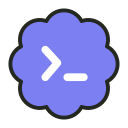
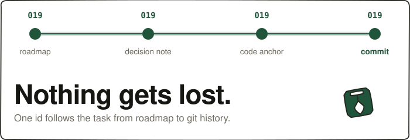

<div align="center">
  <picture>
    <source media="(prefers-color-scheme: dark)" srcset="assets/banner-dark.png" />
    
  </picture>
  <h1>Foreman</h1>
  <p><strong>Your plan stays next to your code. The next task arrives with its context checked.</strong></p>
</div>

<p align="center"><strong>Available on</strong></p>
<table align="center">
  <tr>
    <td align="center"><a href="#claude-code"><br />Claude Code, primary host</a></td>
    <td align="center"><a href="#codex"><br />Codex</a></td>
    <td align="center"><a href="#antigravity"><br />Antigravity</a></td>
  </tr>
</table>

<p align="center"><a href="#install"><strong>Get started</strong></a> · <a href="#what-is-this">What is this?</a> · <a href="#how-it-works">How it works</a> · <a href="#what-you-can-do">What you can do</a> · <a href="#the-numbers">Evidence</a></p>

## What is this?

Foreman is a plugin for Claude Code, an AI coding assistant. It also runs on Codex and Antigravity, two other coding assistants.

You finish a session with a fix, a side request and an issue waiting. Next time, which comes first, and why? Foreman keeps that context in a roadmap beside your code.

<p align="center"></p>

*Ember is the mascot of the Foundry plugins. The scene is an illustration, not a measurement.*

**You ask:** "What's next?"

**You get:** ranked tasks, each with its reason, and one marked recommended. Your pick comes with a prompt checked against your files. Then Foreman asks where to run it.

This example is an illustration, not recorded output.

## Why you'd want it

- **Pick up where you stopped.** The next session starts from the plan.
- **Tasks keep their reasons.** Each carries its why and its limits.
- **Stale plans get checked.** Foreman can compare the plan with the code.
- **You decide what is done.** A passing test run is not acceptance.

## How it works

Foreman keeps your plan in `ROADMAP.jsonl`, a text file with one task per line. Settings and archive sit beside it in `.foreman/`. Do not edit it by hand; tell Foreman what is wrong.

| Moment | What happens |
| --- | --- |
| You ask "what's next?" | Foreman sorts the roadmap, recommends one task and writes the prompt. You still choose |
| You describe new work | It goes on the roadmap. Foreman asks first only when it looks like something already tracked |
| You commit | If a task looks finished, Foreman asks you to confirm. It also offers new work it noticed, unless you switch that off |
| You start a new session | Foreman mentions tasks still in progress or waiting for your acceptance, and offers to archive finished entries once many have piled up |

A task with committed, checked work waits as `awaiting_acceptance`. Your yes closes it.

One task id links the plan to the commit. An illustration, not a measurement:

<p align="center"></p>

[How Foreman works](docs/knowledge/how-it-works.md) covers the rest.

## What you can do

| You want to | What you get |
| --- | --- |
| Add work to the roadmap | Requested work recorded with its reason and boundaries |
| See where things stand | Status, blockers and work waiting for acceptance |
| Choose the next task | A recommended task and a choice of where to run it |
| Check whether the plan still matches the code | A grounded review before choosing work |
| Get a prompt for one-off work | A checked handoff without requiring a roadmap entry |
| See the open tasks in a pane | The roadmap pane, in Claude Code only |
| Review each result before the next one | Reviewed increments, in Codex only |

### How to ask

Plain sentences work in every assistant: "add this to the roadmap" or "what's next?". To call Foreman by name, use a skill, a command the plugin adds. [Calling Foreman by name](docs/knowledge/how-it-works.md#calling-foreman-by-name) covers the Codex `$` prefix.

| You want to | Claude Code | Codex | Antigravity |
| --- | --- | --- | --- |
| Ask in your own words | `/foreman:foreman` | the `foreman` skill, or `$foreman:foreman` in a prompt | `/foreman` |
| Set up a roadmap for a project (once) | `/foreman:init` | the `init` skill, or `$foreman:init` in a prompt | `/init` |
| Pick, add, correct or review work | `/foreman:roadmap` | the `roadmap` skill, or `$foreman:roadmap` in a prompt | `/roadmap` |
| Check the plan against your code | `/foreman:survey` | the `survey` skill, or `$foreman:survey` in a prompt | `/survey` |
| Write a one-off prompt with no roadmap entry | `/foreman:craft-prompt` | the `craft-prompt` skill, or `$foreman:craft-prompt` in a prompt | `/craft-prompt` |

### Settings

Settings live in `.foreman/config.json`, one file for every host. Init writes it as `{}`, and a missing key means the default. Three are common:

| Setting | Values | What it does |
| --- | --- | --- |
| `requireVerification` | `true` (default), `false` | `true` holds a committed task at `awaiting_acceptance` until you confirm it. `false` closes it when its commit lands. |
| `discoverySuggestions` | `true` (default), `false` | `true` offers work Foreman noticed that the roadmap does not track, and asks before adding anything. |
| `checkpoints` | An object | How a split run saves its work: the base branch, whether to use a branch and what to do at the end. |

[Foreman settings](docs/knowledge/settings.md) lists every setting and variable.

## Install

### Claude Code

You need Claude Code 2.1.323 or later, Node.js, and Git 2.25 or later. Foreman is tested with Node.js 22.

Inside Claude Code, run:

```text
/plugin marketplace add V-Songbird/foundry
/plugin install foreman@foundry
```

Then start a new session.

To check that it worked, run `claude plugin list` in a terminal. The list names `foreman`. Then run `/foreman:init` once in the project. Init creates `ROADMAP.jsonl` and `.foreman/config.json`.

### Codex

You need Codex with plugin support, Node.js, and Git 2.25 or later.

In a terminal, run:

```text
codex plugin marketplace add V-Songbird/foundry
codex plugin add foreman@foundry
```

Trust its hooks with `/hooks`; they do nothing until you do. Then start a new session.

To check that it worked, run `codex plugin list --marketplace foundry`. Then ask Foreman to initialize the project, or type `$foreman:init`.

### Antigravity

You need the Antigravity CLI, Node.js, and Git 2.25 or later. Antigravity has no marketplace for third-party plugins, so you install from a copy of the [Foundry repository](https://github.com/V-Songbird/foundry). Replace `<path-to-clone>` with a folder of your choice.

In a terminal, run:

```shell
git clone --recurse-submodules https://github.com/V-Songbird/foundry.git <path-to-clone>
agy plugin install <path-to-clone>/foreman
agy plugin list
```

Then start a new conversation. The list names `foreman` when it worked. Run `/init` once in the project.

### Update

In Claude Code, run these. Then start a new session:

```text
/plugin marketplace update foundry
/plugin update foreman@foundry
```

In Codex, run these. Then start a new session. A changed hook stays off until you trust it again in `/hooks`:

```text
codex plugin marketplace upgrade
codex plugin remove foreman@foundry
codex plugin add foreman@foundry
```

In Antigravity, run these. Then start a new conversation:

```shell
git -C <path-to-clone> pull
git -C <path-to-clone> submodule update --init
agy plugin uninstall foreman
agy plugin install <path-to-clone>/foreman
```

## Good to know

| Limit | What it means for you |
| --- | --- |
| Built for one developer | Foreman is no team tracker, scheduler or workflow server. It needs no server or account. |
| Antigravity installs | Install only from a Foundry copy. The install changes only when you install again. |
| Hand edits | A hook stops the assistant's file-editing tools from changing `ROADMAP.jsonl`. A shell command is not stopped on any host. |
| Cost of a pick | **Fast pick**, the default, adds roughly 10,000 to 16,000 tokens. **Reconcile and pick** costs more. |
| Switching between assistants | Every assistant reads the same files, so a project can move between them. Keep the files as they are and do not reinitialize. |
| Copied prompts | A prompt carries the script paths of the install that crafted it. Craft it again in another assistant. |
| Prompt file left behind | A copied prompt's file can stay in the project's `tmp/` folder. Move it out before a task runs. |
| Hosts differ | Each host offers different events and tools. The task-end reminder and the roadmap pane do not exist on every host. |
| Quiet failures | Foreman cannot tell when a host stops sending an event it relies on. Its automatic help goes quiet, and every command keeps working by hand. |
| Codex on Windows | Git writes need your approval to leave the sandbox, and the `workspace-write` sandbox cannot write to `.git`. |
| Codex subagent names | A subagent named `foreman` or `foreman_…` is refused unless it is `foreman_<id>` of a roadmap entry. |
| Codex trust entries | Removing the plugin leaves its hook trust entries in `config.toml`. |
| Codex, unverified | Several Codex paths were never run live, such as a full reviewed-increment handoff, the app on macOS, and Codex on Linux or macOS. |
| Antigravity | Four actions were checked live in Antigravity on Windows. After a commit, Foreman's words reach only the next model call. |
| Antigravity from Claude Code | Started from a Claude Code shell, it counts as Claude Code. |

[Foreman limits](docs/knowledge/limits.md) states each one in full.

### Ids a committed roadmap publishes

| Id | What to know |
| --- | --- |
| The Codex session id | A paused Codex review writes it into the entry's notes. The session id stays in the roadmap on purpose, so a later pick on the same machine can offer the resume command. It resumes something only under the `CODEX_HOME` directory of the machine that ran it |
| What a commit publishes | Still, when a project commits `ROADMAP.jsonl`, the commit publishes the id, along with the background agent and subagent ids that dispatch notes record. A committed `.foreman/config.json` publishes the ids in `delegatedAcceptance`. A project that must not publish such ids keeps those files out of Git |

## The numbers

Each figure comes from recorded test sessions. The figures describe those runs, not yours, and results vary between runs. The run gave two models the same tasks with Foreman and with a written task paragraph.

### Claude Code results

<!-- foundry:evidence {"platform":"Claude","status":"measured","models":["Claude Sonnet 5","Claude Opus 5"],"source":"docs/knowledge/benchmarks.md","date":"2026-08-29","reviewedAt":"2026-10-12","revision":"not recorded","revisionReason":"No public record names the Foreman revision the 2026-08-29 run measured."} -->
| Model | Setup | Correct tasks | Mean session cost |
| --- | --- | --- | --- |
| Claude Sonnet 5 | Written task paragraph | 100% | $0.0757 |
| Claude Sonnet 5 | Foreman | 100% | $0.0820 |
| Claude Opus 5 | Written task paragraph | 100% | $0.1627 |
| Claude Opus 5 | Foreman | 100% | $0.1746 |

The run is from 2026-08-29. Neither the sample size nor the Foreman revision was recorded. The current release has no separate measurement.

**Foreman cost more.** It tied on correctness and added 8.3% on Sonnet and 7.3% on Opus.

<details>
<summary>Watch the recorded demo: one "what's next?" exchange, on Claude Opus 5</summary>

<p align="center"></p>

</details>

### Codex results

<!-- foundry:evidence {"platform":"Codex","status":"pending","source":"docs/knowledge/benchmarks.md","reason":"Functional Codex validation exists; equivalent paired performance measurements are not available."} -->
| Model | Setup | Correct tasks | Mean session cost |
| --- | --- | --- | --- |
| Not measured | Not measured | Not measured | Not measured |

No Codex session has been measured yet. No Claude Code result stands in for it.

### Antigravity results

<!-- foundry:evidence {"platform":"Antigravity","status":"pending","source":"docs/knowledge/benchmarks.md","reason":"No Antigravity performance measurements are available."} -->
| Model | Setup | Correct tasks | Mean session cost |
| --- | --- | --- | --- |
| Not measured | Not measured | Not measured | Not measured |

No Antigravity session has been measured yet.

[Foreman benchmarks](docs/knowledge/benchmarks.md) holds each figure's limits.

## Going deeper

[How Foreman works](docs/knowledge/how-it-works.md) · [Foreman settings](docs/knowledge/settings.md) · [Foreman limits](docs/knowledge/limits.md) · [Foreman benchmarks](docs/knowledge/benchmarks.md)

Release notes are on the [Foreman releases page](https://github.com/V-Songbird/foreman/releases). [Foundry](https://github.com/V-Songbird/foundry) lists the whole family.

Report a bug or ask a question on [Foreman's issue tracker](https://github.com/V-Songbird/foreman/issues). Report a vulnerability as [SECURITY.md](SECURITY.md) says. To change Foreman, read [CONTRIBUTING.md](CONTRIBUTING.md).

## License

MIT, see [LICENSE](LICENSE).
