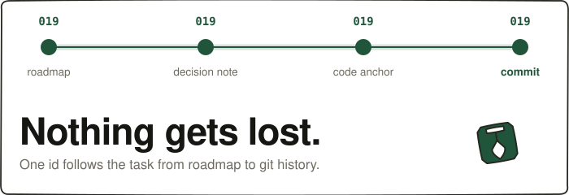

# How Foreman works

This page says what Foreman does in a project, part by part. It is for a user who wants to predict what Foreman will do. The short form is in the README, under [What does it do?](../../README.md#what-does-it-do).

## Contents

- [What you can do](#what-you-can-do)
- [Why you would want it](#why-you-would-want-it)
- [The roadmap file](#the-roadmap-file)
- [Two ways to get a task](#two-ways-to-get-a-task)
- [The prompt is checked before you see it](#the-prompt-is-checked-before-you-see-it)
- [Finished is not the same as accepted](#finished-is-not-the-same-as-accepted)
- [Big tasks get split](#big-tasks-get-split)
- [Where a task can go](#where-a-task-can-go)
- [Task numbers in your history](#task-numbers-in-your-history)
- [The roadmap pane](#the-roadmap-pane)
- [Review between increments](#review-between-increments)
- [Calling Foreman by name](#calling-foreman-by-name)

## What you can do

| You want to | What you get |
| --- | --- |
| Add work to the roadmap | Requested work recorded with its reason and boundaries |
| See where things stand | Status, blockers and work waiting for acceptance |
| Choose the next task | A recommended task and a choice of where to run it |
| Check whether the plan still matches the code | A grounded review before choosing work |
| Get a prompt for one-off work | A checked handoff without requiring a roadmap entry |
| See the open tasks in a pane | The roadmap pane, in Claude Code only |
| Review each result before the next one | Reviewed increments, in Codex only |

### How to ask

Plain sentences work in every assistant: "add this to the roadmap" or "what's next?". To call Foreman by name, use a skill, a command the plugin adds. [Calling Foreman by name](#calling-foreman-by-name) covers the Codex `$` prefix.

| You want to | Claude Code | Codex | Antigravity |
| --- | --- | --- | --- |
| Ask in your own words | `/foreman:foreman` | the `foreman` skill, or `$foreman:foreman` in a prompt | `/foreman` |
| Set up a roadmap for a project (once) | `/foreman:init` | the `init` skill, or `$foreman:init` in a prompt | `/init` |
| Pick, add, correct or review work | `/foreman:roadmap` | the `roadmap` skill, or `$foreman:roadmap` in a prompt | `/roadmap` |
| Check the plan against your code | `/foreman:survey` | the `survey` skill, or `$foreman:survey` in a prompt | `/survey` |
| Write a one-off prompt with no roadmap entry | `/foreman:craft-prompt` | the `craft-prompt` skill, or `$foreman:craft-prompt` in a prompt | `/craft-prompt` |

## Why you would want it

- **Pick up where you stopped.** The next session starts from the plan.
- **Tasks keep their reasons.** Each carries its why and its limits.
- **Stale plans get checked.** Foreman can compare the plan with the code.
- **You decide what is done.** A passing test run is not acceptance.

One task id links the plan to the commit. An illustration, not a measurement:

## The roadmap file

Foreman keeps your plan in `ROADMAP.jsonl`, an ordinary text file in your project with one task per line. You can read it with Foreman switched off, keep it in version control and open it in any editor. Its settings and archive sit beside it in `.foreman/`.

Do not edit the roadmap by hand. Tell Foreman what is wrong, and it fixes the entry. It checks the whole file before and after each write.

A hook stops the assistant's file-editing tools from changing the file directly. A shell command is not stopped on any host.

The commands that write text refuse text that looks like a credential. These are `add`, `update-status`, `annotate` and `correct`.

The error names the field and the kind of credential, never the text, and nothing is written. Remove the credential and send the call again.

The kinds are an API key (`sk-`), a GitHub token, an AWS access key id, a Slack token, a private key block, an Authorization header value and a password inside a URL. Only new writes are checked; text already in the file stays readable.

| Moment | What happens |
| --- | --- |
| You ask "what's next?" | Foreman sorts the roadmap: what is finished, what waits on something else, and what would put two jobs in the same files. It recommends one and writes the prompt. You still choose |
| You describe new work | It goes on the roadmap. Foreman asks first only when it looks like something already tracked |
| You commit | If a task looks finished, Foreman asks you to confirm. It also offers new work it noticed along the way, unless you switch that off |
| You start a new session | Foreman mentions tasks still in progress or waiting for your acceptance, and offers to archive finished entries once many have piled up |

## Two ways to get a task

- **Fast pick** is the default. Foreman sorts the roadmap it already has and recommends one task. It reads no code. Its own instructions still add roughly 10,000 to 16,000 tokens to the session, depending on the host.
- **Reconcile and pick** reads your code first, finds where the plan has gone stale, and offers you each fix before recommending anything. It does everything Fast pick does and reads code on top, so it always costs more. Foreman never starts it on its own; you have to ask.

## The prompt is checked before you see it

Foreman opens the files a task expects to touch before it hands you a prompt. It catches these problems:

- A moved or renamed file.
- A path outside your project, which it refuses.
- A name in the task that matches nothing in those files, which it flags.

A file the task will create is marked as new.

Names are read from JavaScript, TypeScript, Python and Kotlin files. Other file types get the path checks alone, with a warning.

The prompt itself is checked too, for a missing step or a verification command that cannot run. An investigation asks for findings with evidence, not fixes. A decision asks for a choice and its reason.

## Finished is not the same as accepted

A task whose work is committed and checked waits for you, marked `awaiting_acceptance`. Your yes closes it. "Not ready" sends it back with what you said.

Passing tests are evidence, not acceptance. A background worker's report that it succeeded is evidence too. The `requireVerification` setting changes this default; see [Foreman settings](settings.md).

## Big tasks get split

A task with several separate checks can be handed off in pieces, each with its own check. Every finished piece is committed on a work branch, so nothing is lost if you stop halfway. At the end you decide what happens to that branch.

Only the last piece closes the roadmap entry. Foreman's commits carry only the task's own files. A run that starts with uncommitted changes in your working tree makes no automated commits at all.

## Where a task can go

When a prompt is ready, Foreman asks where it should run:

1. Here.
2. Here, split by check.
3. With a background worker.
4. Copied for another session.

It recommends one from how full the session is, other work in flight, the number of checks and whether your tree is clean. The choice stays yours.

In Codex and Antigravity, the session that sent a background worker checks its result and makes the roadmap changes itself.

## Task numbers in your history

Every commit Foreman makes ends with a line like `Foreman: 019`, so `git log` traces any change to its task. When a task names a function, the prompt lists the earlier tasks that changed it, as history. A `[Foreman: 019]` comment next to code names the task that settled it.

## The roadmap pane

The pane is for Claude Code only. Codex and Antigravity have no pane.

In a project that has a `ROADMAP.jsonl`, a **Roadmap** button joins the mode labels at the right of the prompt footer, in the terminal and in the desktop app. VS Code and mobile show no button, and neither does a project with no `ROADMAP.jsonl`.

The button opens a pane with the open tasks in four sections: in progress, ready, blocked and deferred.

- In the desktop app, the pane sits beside the conversation.
- In the terminal, it docks only in fullscreen at 110 columns or wider, and otherwise appears above the prompt.

Press a task to see its card: its status, who made it and when, what it depended on, up to three planned files and its reason. A search box filters by number, title or reason.

The pane only reads the file; it never writes it. A card's **Resume**, **Accept** or **Pick** button sends one request as your next prompt, "Pick roadmap entry 12 with Foreman". Foreman's pick flow then handles that entry by its status:

- It resumes the entry.
- It waits for your own answer before accepting it.
- It asks how you want to run it before any work starts.

**To prompt** puts the same sentence in the prompt box instead, ahead of anything you already typed, so you can add a hint before sending.

The pane speaks Spanish when Claude Code's `language` setting names Spanish. A roadmap over 4 MiB is not shown; ask Foreman to archive the finished tasks. The roadmap check warns once the file reaches 3 MiB. If a line of `ROADMAP.jsonl` cannot be read, the pane says so instead of listing the rest.

## Review between increments

This is for Codex only. Claude Code and Antigravity do not offer it.

You can ask Foreman to run one roadmap task in increments, which are results you can look at and try, and wait for your decision after each one.

Start a new Codex task after installing or updating, then ask plainly, for example: "Foreman, run this task here in increments and wait for my approval after each result."

Only that explicit request turns it on, for that one run. It is not a setting.

After each increment, the session shows the result, its limits, the evidence and what to look at. It then offers **Accept / Request changes / Pause** and waits for a real answer before any dependent work. Passing tests and time passing are not answers.

With no person or coordinator to answer, the result stays pending and the run stops. A subagent returns its result to the session that sent it, and running in the background never supplies an answer.

After two failed fix attempts the session reports and pauses. Accepting one increment keeps the task open. The usual close rules apply once every increment is done.

Nothing is skipped automatically. A check you explicitly let go is recorded as `unverified:`, never as accepted. It stays open until later evidence for that same result resolves it, and accepting another result does not clear it.

Recovery after an interruption is assisted, not automatic. The session rereads the notes and the work, and asks again when they no longer agree.

### Resuming a paused review

A paused review can continue later from a new process with `codex exec resume <session id> -`. The command reads your decision from standard input. End the input with Ctrl+D in a POSIX shell, or with Ctrl+Z and Enter in PowerShell or cmd.

To keep Codex's reply in a file, run `codex exec resume -o <file> <session id> -`. In one run, Git Bash's window closed right after Ctrl+D and the reply was not on screen.

If you decline the command when a pick offers it, Foreman does not offer it again. A session Codex no longer knows falls back to recovery from the notes and files.

## Calling Foreman by name

Plain sentences work in every assistant: "add this to the roadmap", "where are we?", "what's next?", "check whether the plan still matches the code" or "craft a prompt for this". The commands for each assistant are in the [How to ask](#how-to-ask) table.

In Codex, mention a skill with its plugin prefix, such as `$foreman:roadmap`, and Codex attaches that skill's instructions to your message. A bare `$roadmap` is not attached; Codex leaves it to the model to find the skill.
